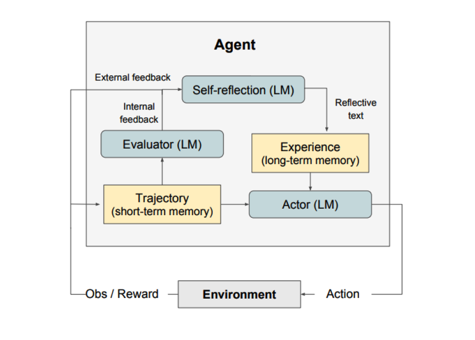
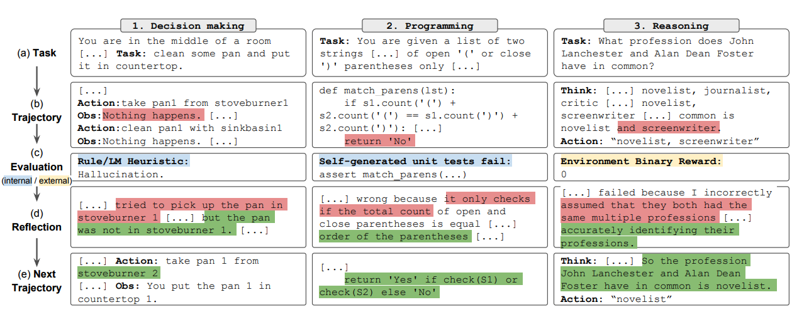
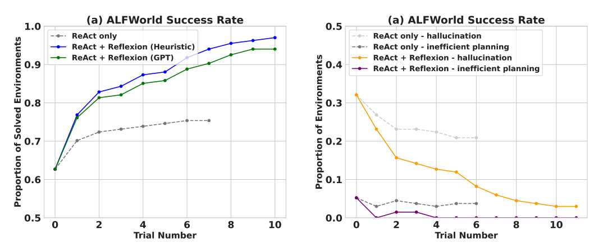
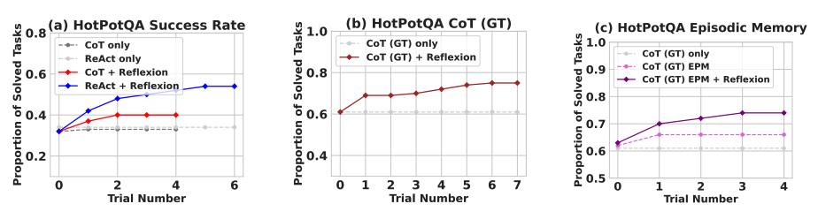
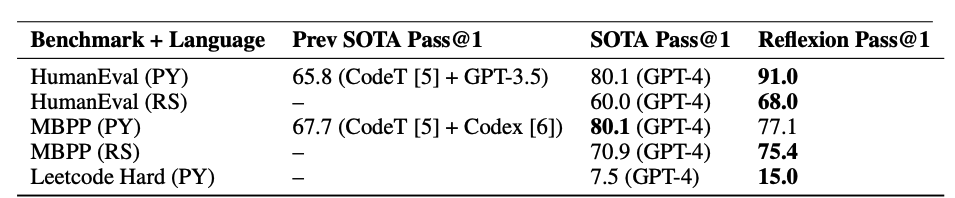

# Reflexion

import { CoursePromo, CoursesSection, CourseCard } from '../../components/CourseCard'

Reflexion es un marco de trabajo para reforzar agentes basados en lenguaje mediante retroalimentación lingüística. Según [Shinn et al. (2023)](https://arxiv.org/pdf/2303.11366.pdf), "Reflexion is a new paradigm for 'verbal' reinforcement that parameterizes a policy as an agent's memory encoding paired with a choice of LLM parameters."

A alto nivel, Reflexion convierte la retroalimentación del entorno (ya sea lenguaje de forma libre o escalar) en retroalimentación lingüística, también denominada **autorreflexión** (self-reflection), que se proporciona como contexto a un agente LLM en el siguiente episodio. Esto ayuda al agente a aprender de forma rápida y eficaz de errores previos, lo que se traduce en mejoras de rendimiento en muchas tareas avanzadas.

Como se muestra en la figura anterior, Reflexion consta de tres modelos distintos:

- **Un Actor (Actor)**: genera texto y acciones a partir de las observaciones del estado. El Actor toma una acción en un entorno y recibe una observación, lo que da lugar a una trayectoria. Se utilizan [Chain-of-Thought (CoT)](https://www.promptingguide.ai/techniques/cot) y [ReAct](https://www.promptingguide.ai/techniques/react) como modelos de Actor. También se añade un componente de memoria para aportar contexto adicional al agente.
- **Un Evaluador (Evaluator)**: puntúa las salidas producidas por el Actor. En concreto, toma como entrada una trayectoria generada (también denominada memoria a corto plazo) y produce una puntuación de recompensa. Se utilizan distintas funciones de recompensa según la tarea (para las tareas de toma de decisiones se emplean LLMs y heurísticas basadas en reglas).
- **Autorreflexión (Self-Reflection)**: genera señales de refuerzo verbal para ayudar al Actor a mejorar por sí mismo. Este rol lo desempeña un LLM y aporta retroalimentación valiosa para los intentos futuros. Para generar retroalimentación específica y relevante, que también se almacena en memoria, el modelo de autorreflexión utiliza la señal de recompensa, la trayectoria actual y su memoria persistente. Estas experiencias (almacenadas en la memoria a largo plazo) las aprovecha el agente para mejorar rápidamente la toma de decisiones.

En resumen, los pasos clave del proceso de Reflexion son a) definir una tarea, b) generar una trayectoria, c) evaluar, d) realizar la reflexión y e) generar la siguiente trayectoria. La figura siguiente muestra ejemplos de cómo un agente Reflexion puede aprender a optimizar iterativamente su comportamiento para resolver diversas tareas como la toma de decisiones, la programación y el razonamiento. Reflexion amplía el marco ReAct al introducir componentes de autoevaluación, autorreflexión y memoria.

## Resultados

Los resultados experimentales demuestran que los agentes Reflexion mejoran significativamente el rendimiento en las tareas de toma de decisiones de AlfWorld, las preguntas de razonamiento de HotPotQA y las tareas de programación en Python de HumanEval.

Al evaluarse en tareas secuenciales de toma de decisiones (AlfWorld), ReAct + Reflexion supera con claridad a ReAct al completar 130/134 tareas usando técnicas de autoevaluación mediante heurística y GPT para clasificación binaria.

Reflexion supera significativamente a todos los enfoques de referencia a lo largo de varios pasos de aprendizaje. Solo para razonamiento, y al añadir una memoria episódica formada por la trayectoria más reciente, Reflexion + CoT supera a CoT solo y a CoT con memoria episódica, respectivamente.

Como se resume en la tabla siguiente, Reflexion suele superar a los enfoques anteriores del estado del arte en la escritura de código en Python y Rust en MBPP, HumanEval y Leetcode Hard.

## ¿Cuándo usar Reflexion?

Reflexion es más adecuado para lo siguiente:

1. **Un agente necesita aprender por ensayo y error**: Reflexion está diseñado para ayudar a los agentes a mejorar su rendimiento reflexionando sobre errores pasados e incorporando ese conocimiento a decisiones futuras. Esto lo hace idóneo para tareas en las que el agente necesita aprender por ensayo y error, como la toma de decisiones, el razonamiento y la programación.

2. **Los métodos tradicionales de aprendizaje por refuerzo no son prácticos**: los métodos tradicionales de aprendizaje por refuerzo (RL) suelen requerir grandes cantidades de datos de entrenamiento y un costoso ajuste fino (fine-tuning) del modelo. Reflexion ofrece una alternativa ligera que no requiere ajustar el modelo de lenguaje subyacente, lo que lo hace más eficiente en cuanto a datos y recursos de cómputo.

3. **Se requiere retroalimentación matizada**: Reflexion utiliza retroalimentación verbal, que puede ser más matizada y específica que las recompensas escalares empleadas en el RL tradicional. Esto permite al agente entender mejor sus errores y realizar mejoras más precisas en los intentos posteriores.

4. **La interpretabilidad y la memoria explícita son importantes**: Reflexion proporciona una forma de memoria episódica más interpretable y explícita que los métodos tradicionales de RL. Las autorreflexiones del agente se almacenan en su memoria, lo que facilita el análisis y la comprensión de su proceso de aprendizaje.

Reflexion es eficaz en las siguientes tareas:

- **Toma de decisiones secuencial**: los agentes Reflexion mejoran su rendimiento en las tareas de AlfWorld, que implican navegar por distintos entornos y completar objetivos de varios pasos.
- **Razonamiento**: Reflexion mejoró el rendimiento de los agentes en HotPotQA, un conjunto de datos de preguntas y respuestas que requiere razonar sobre múltiples documentos.
- **Programación**: los agentes Reflexion escriben mejor código en benchmarks como HumanEval y MBPP, alcanzando resultados del estado del arte en algunos casos.

Estas son algunas limitaciones de Reflexion:

- **Dependencia de la capacidad de autoevaluación**: Reflexion depende de la capacidad del agente para evaluar con precisión su rendimiento y generar autorreflexiones útiles. Esto puede ser un reto, especialmente en tareas complejas, aunque se espera que Reflexion mejore con el tiempo a medida que los modelos sigan aumentando sus capacidades.
- **Limitaciones de la memoria a largo plazo**: Reflexion utiliza una ventana deslizante con capacidad máxima, pero para tareas más complejas puede ser ventajoso usar estructuras avanzadas como embeddings vectoriales o bases de datos SQL.
- **Limitaciones en la generación de código**: existen limitaciones en el desarrollo guiado por pruebas (test-driven development) a la hora de especificar correspondencias precisas entre entradas y salidas (por ejemplo, funciones generadoras no deterministas y salidas de funciones influidas por el hardware).

---

*Fuente de las figuras: [Reflexion: Language Agents with Verbal Reinforcement Learning](https://arxiv.org/pdf/2303.11366.pdf)*

## Referencias

- [Reflexion: Language Agents with Verbal Reinforcement Learning](https://arxiv.org/pdf/2303.11366.pdf)
- [Can LLMs Critique and Iterate on Their Own Outputs?](https://evjang.com/2023/03/26/self-reflection.html)

<CoursesSection title="Related Learning">
  <CourseCard
    tag="Course"
    tagColor="blue"
    title="Prompt Engineering for LLMs"
    description="Master Reflexion, self-reflection, and advanced techniques for iterative improvement."
    href="https://academy.dair.ai/courses/introduction-prompt-engineering"
    level="Beginner"
    duration="2 hours"
  />
  <CourseCard
    tag="Course"
    tagColor="purple"
    title="Building Effective AI Agents"
    description="Learn to build effective AI agents with Reflexion patterns. Covers function calling and agentic systems."
    href="https://academy.dair.ai/courses/building-effective-ai-agents"
    level="Intermediate"
    duration="5 hours"
  />
</CoursesSection>

<CoursePromo
  title="Explore All Courses"
  description="Discover our full catalog of AI and prompt engineering courses. From beginners to advanced practitioners."
  href="https://academy.dair.ai/"
  buttonText="Browse Academy"
  promoCode="PROMPTING20"
/>
